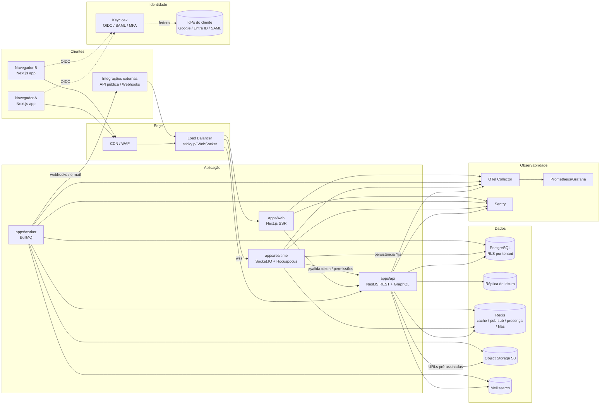
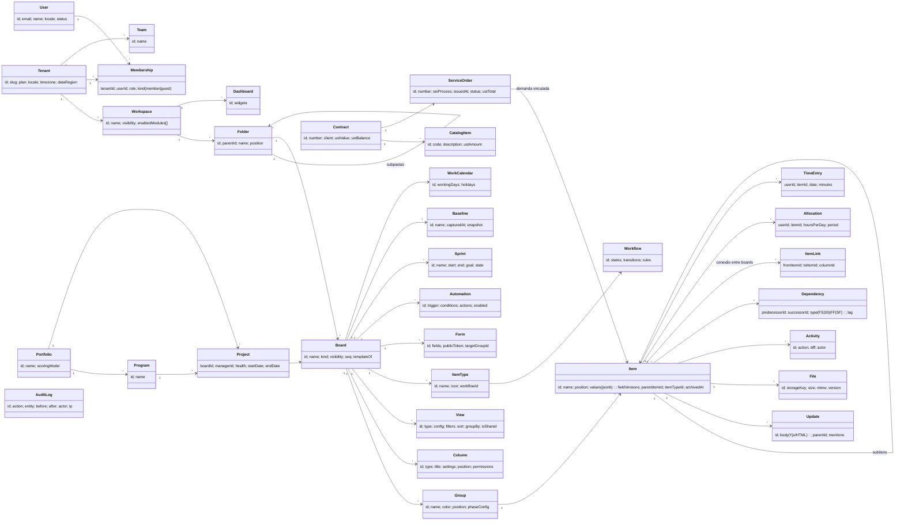

# CUBE TRACK — Arquitetura

> Status: **Proposta (Prompt 1)** — aguardando validação. Decisões formais em `docs/adr/`.

Sumário
1. [Arquitetura de alto nível](#1-arquitetura-de-alto-nível)
2. [Estratégia de tempo real](#2-estratégia-de-tempo-real)
3. [Estratégia de colunas customizáveis](#3-estratégia-de-colunas-customizáveis)
4. [Multi-tenancy e isolamento](#4-multi-tenancy-e-isolamento)
5. [Estrutura do monorepo](#5-estrutura-do-monorepo)
6. [Modelo de domínio preliminar](#6-modelo-de-domínio-preliminar)
7. [Premissas e dúvidas](#7-premissas-e-dúvidas)
8. [Requisitos não funcionais e metas](#8-requisitos-não-funcionais-e-metas)

---

## 1. Arquitetura de alto nível

### 1.1 Estilo arquitetural

**Monólito modular** (NestJS) com *bounded contexts* bem delimitados, mais **três processos separados por perfil de escala**:

| Processo | Responsabilidade | Escala por |
|---|---|---|
| `apps/web` | UI Next.js (SSR do shell, app cliente) | requisições HTTP |
| `apps/api` | Comandos e consultas (REST + GraphQL), regras de negócio, autorização, outbox | CPU / requisições |
| `apps/realtime` | Conexões WebSocket (Socket.IO), presença, fan-out de eventos, colaboração Yjs (Hocuspocus) | nº de conexões abertas |
| `apps/worker` | Jobs BullMQ: relay do outbox, automações, notificações, indexação de busca, rollups, importações, relatórios, IA | profundidade das filas |

> **Mudança em relação à stack sugerida:** adicionamos `apps/realtime`. Conexões WebSocket são longas e escalam por memória/FDs, não por CPU; separá-las do `apps/api` permite deploys da API sem derrubar conexões e autoscaling independente (ADR 0007). O código compartilha os mesmos pacotes (`packages/shared`, `packages/db`).

Microsserviços foram descartados neste estágio (ADR 0003): o domínio tem muitas transações que atravessam contextos (item + auditoria + outbox + rollup), e a sobrecarga operacional não se paga antes de haver times independentes.

### 1.2 Diagrama de componentes



### 1.3 Fluxo de dados de uma escrita (ex.: mudar status de um item)

```mermaid
sequenceDiagram
  autonumber
  participant A as Navegador A
  participant API as apps/api
  participant PG as PostgreSQL
  participant R as Redis (pub/sub)
  participant RT as apps/realtime
  participant B as Navegador B
  participant W as apps/worker

  A->>A: Update otimista no cache (clientMutationId)
  A->>API: PATCH /items/:id/values {columnId, value, baseVersion}
  API->>PG: BEGIN; SET LOCAL app.tenant_id
  API->>PG: valida permissão + regra de workflow
  API->>PG: UPDATE item (JSONB + projeção tipada + field_versions)
  API->>PG: INSERT audit_log, outbox_event (board_seq++)
  API->>PG: COMMIT
  API-->>A: 200 {item, version, boardSeq}
  API->>R: PUBLISH board:{id} evento (fast path)
  R->>RT: evento
  RT->>RT: filtra por permissão (coluna/convidado)
  RT-->>B: item.updated (patch)
  RT-->>A: item.updated (dedupe por clientMutationId)
  W->>PG: outbox relay (garantia, at-least-once)
  W->>R: republica se não marcado como publicado
  W->>W: automações, notificações, indexação, rollups
```

### 1.4 Padrões transversais

- **Outbox transacional**: todo evento de domínio é gravado na mesma transação que a mudança. A API publica imediatamente após o commit (*fast path*, atinge a meta de < 300 ms); o worker faz o relay das linhas não publicadas (*garantia*). Consumidores são idempotentes por `eventId` (ADR 0012).
- **CQRS leve**: comandos via REST; leituras compostas (dashboards, portfólio) via GraphQL, que pode usar réplica de leitura. Mesmo banco, sem event sourcing.
- **Auditoria**: append-only, gravada na transação do comando (ADR 0015).
- **Feature modules por workspace**: Contratos/OS/UST, Sprints, Timesheet etc. são ativados por workspace via registro de módulos (ADR 0017).

### 1.5 Bounded contexts

| Contexto | Responsabilidade |
|---|---|
| **Identity & Access** | Tenants, usuários, times, convidados, papéis, permissões, SSO, MFA, SCIM, API keys |
| **Workspace & Structure** | Workspaces, pastas, boards, grupos, templates |
| **Work Items** | Itens, subitens, colunas, valores, tipos de item, dependências, links entre boards |
| **Views** | Views salvas (tabela, kanban, calendário, timeline, gantt, formulário, mapa), filtros, ordenação |
| **Collaboration** | Atualizações (feed), @menções, reações, arquivos, documentos (Yjs), log de atividade |
| **Process & Automation** | Workflows (estados/transições), fases (Pipefy), formulários, SLA, regras de automação |
| **Planning** | Sprints, backlog, cronograma, dependências, caminho crítico, baselines, calendários de trabalho |
| **Resources** | Capacity, alocação, timesheet |
| **Portfolio** | Projetos, programas, portfólios, priorização/scoring, health, rollups |
| **Analytics** | Dashboards, widgets, agregações, exportações |
| **Contracts** *(opcional)* | Contratos, itens de catálogo, OS, UST, medição, faturamento |
| **Notifications** | Inbox, e-mail, push, preferências, digest |
| **Search** | Indexação e busca global |
| **Integration** | API pública, webhooks, importadores (Monday, Jira, Trello, CSV/Excel), conectores |
| **Audit & Compliance** | Trilha de auditoria, LGPD (exportação/anonimização), retenção |
| **AI** | Assistentes, resumo, chatbot sobre o board, sugestões |

---

## 2. Estratégia de tempo real

### 2.1 Transporte

- **Socket.IO** sobre WebSocket (fallback long-polling) em `apps/realtime`, com **`@socket.io/redis-adapter`** (Redis Pub/Sub; *sharded pub/sub* do Redis 7 quando o volume exigir) para fan-out entre réplicas.
- Autenticação no handshake com o **access token** (JWT curto, emitido pela API após OIDC). Token renovado em conexão aberta via evento `auth.refresh`; expirado → desconexão.
- **Hocuspocus** (servidor Yjs) no mesmo processo, em namespace/path separado (`/collab`), para documentos rich text; extensão Redis para múltiplas réplicas e persistência em PostgreSQL.
- Sticky sessions no LB apenas para o fallback de long-polling.

### 2.2 Canais (rooms)

| Room | Quem entra | Eventos |
|---|---|---|
| `t:{tenantId}` | todos os usuários do tenant | mudanças de estrutura global (workspaces, broadcast administrativo) |
| `u:{userId}` | o próprio usuário (todas as abas/dispositivos) | notificações, menções, mudanças de permissão, *force logout* |
| `ws:{workspaceId}` | quem vê a árvore do workspace | pastas e boards criados/renomeados/movidos |
| `b:{boardId}` | quem tem um board/view aberto | itens, grupos, colunas, views, presença no board |
| `i:{itemId}` | quem tem o painel do item aberto | atualizações (feed), arquivos, log, digitando… |
| `d:{dashboardId}` | quem tem o dashboard aberto | invalidações de widgets |
| `doc:{docId}` (Hocuspocus) | editores do documento | updates Yjs, awareness (cursores) |

O cliente faz `subscribe`/`unsubscribe` explicitamente; o servidor **autoriza cada subscribe** consultando a API (com cache em Redis de 60 s invalidado por `permission.changed`).

### 2.3 Envelope de evento

```jsonc
{
  "eventId": "0192f0c4-…",          // UUIDv7, idempotência
  "type": "item.values.updated",     // <entidade>.<ação>
  "tenantId": "…",
  "scope": { "boardId": "…", "itemId": "…" },
  "seq": 18452,                      // sequência monotônica por board
  "actor": { "userId": "…", "kind": "user|automation|api|import" },
  "clientMutationId": "…",          // ecoado para dedupe do autor
  "occurredAt": "2026-10-14T13:00:00.123Z",
  "payload": {
    "changes": [
      { "columnId": "c_status", "value": {"label": "done"}, "version": 42 }
    ]
  },
  "schemaVersion": 1
}
```

Catálogo inicial: `item.created|updated|values.updated|moved|archived|deleted|restored`, `group.*`, `column.*`, `board.*`, `view.*`, `update.created|edited|deleted|reacted`, `file.*`, `dependency.*`, `sprint.*`, `presence.*`, `notification.created`, `permission.changed`. Schemas Zod em `packages/shared/src/events`.

### 2.4 Updates otimistas

1. O cliente gera `clientMutationId` e aplica o patch no cache TanStack Query (camada *pending mutations* por item/campo).
2. Envia o comando via REST (não pelo socket — comandos passam por validação, auditoria e rate limit em um único caminho).
3. **Ack (200)**: confirma o patch com `version` e `seq` do servidor.
4. **Rejeição (403/409/422)**: rollback do patch, toast explicativo; em 409 o cliente recebe o valor atual.
5. O evento do próprio autor chega pelo socket com o mesmo `clientMutationId` e é descartado se já confirmado.
6. Mutações enfileiradas localmente (fila por item) enquanto offline curto; reenvio na reconexão, com `clientMutationId` idempotente no servidor (tabela `idempotency_keys`, TTL 24 h).

### 2.5 Ordenação, reconciliação e lacunas

- Cada board tem um contador `board_seq` (incrementado na transação via `UPDATE boards SET seq = seq + 1 RETURNING seq`, serializando escritas por board — aceitável e desejável; hot-spot monitorado).
- O cliente guarda `lastSeq` por board. Evento com `seq > lastSeq + 1` ⇒ **lacuna** ⇒ pede `GET /boards/:id/events?after=lastSeq`.
- Eventos ficam num **Redis Stream por board** (`XADD` com `MAXLEN ~ 10 000`, TTL 24 h) e no outbox (retenção 7 dias). Se a lacuna não puder ser coberta ⇒ **resync**: refetch das páginas visíveis + metadados do board (cursor pagination mantém a janela).
- Movimentos (drag-and-drop) usam **fractional indexing** (ADR 0013): a posição é uma string entre vizinhos, sem renumerar o grupo; conflitos de mesma posição são desempatados por `id`.

### 2.6 Resolução de conflitos

| Tipo de dado | Estratégia |
|---|---|
| Valores de colunas (status, data, número, pessoas…) | **LWW por campo**, árbitro = ordem de commit no servidor. Cada campo tem `version` (em `field_versions` JSONB). Duas pessoas editando campos diferentes do mesmo item nunca conflitam. |
| Campos com regra (transição de workflow, campos obrigatórios por fase, aprovações) | Comando condicional com `baseVersion`: se mudou desde a leitura ⇒ **409** e o cliente reaplica a regra com o estado atual. |
| Listas multivaloradas (pessoas, tags) | Operações **add/remove** (não substituição do array) ⇒ merges comutativos. |
| Ordem (posição) | Fractional indexing + desempate determinístico. |
| Texto longo / descrições / docs / atualizações em edição | **CRDT Yjs** (Tiptap + Hocuspocus); snapshot em texto/HTML sanitizado projetado no banco para busca e exibição. |
| Estrutura (deletar coluna/grupo em uso) | Soft delete + evento; clientes removem da UI e descartam mutações pendentes com aviso. |

### 2.7 Reconexão

- Backoff exponencial com *jitter* (1 s → 30 s), detecção `online/offline` do navegador.
- Ao reconectar: re-autentica, re-entra nas rooms ativas enviando `{ boardId, lastSeq }`; o servidor responde com eventos faltantes ou `resync_required`.
- Indicador de status de conexão visível (acessível) e edição bloqueada de campos com regra enquanto offline.
- Presença (quem está vendo / editando qual célula) em Redis com TTL de 30 s e heartbeat de 10 s — nunca persistida em PostgreSQL.

### 2.8 Orçamento de latência (p95 < 300 ms ponta a ponta)

| Etapa | Orçamento |
|---|---|
| Rede cliente → API | 40 ms |
| Transação (validação + escrita + outbox + auditoria) | 60 ms |
| Publish Redis → realtime | 10 ms |
| Filtro de permissão + emit | 20 ms |
| Rede realtime → cliente B + render | 70 ms |
| **Folga** | 100 ms |

Medido por OTel (span `realtime.propagation`) e por E2E com dois navegadores + k6.

---

## 3. Estratégia de colunas customizáveis

### 3.1 Requisitos

- ~30 tipos de coluna (texto, número, status, pessoas, data, timeline, dropdown, tags, link, e-mail, telefone, checkbox, rating, arquivo, dependência, conexão entre boards, espelho/lookup, fórmula, progresso, localização, tempo rastreado, UST…).
- Filtros combináveis (E/OU), ordenação multi-coluna, agrupamento e **agregações** (soma, média, contagem por status) em boards de até 50 mil itens.
- Criar/remover colunas **sem DDL** e sem downtime, centenas de boards por tenant.

### 3.2 Comparativo

| Critério | **JSONB** (valores em um documento por item) | **EAV** (uma linha por item×coluna) | **Tabelas dinâmicas** (DDL por board) |
|---|---|---|---|
| Criar/remover coluna | Instantâneo (metadado) | Instantâneo | `ALTER TABLE` por board — locks, migrações, explosão de tabelas |
| Leitura de um item / página | 1 linha, ótimo | N linhas + pivot, caro | 1 linha, ótimo |
| Filtro por igualdade/contém | GIN `jsonb_path_ops` (`@>`) — bom | Índice por (coluna, valor) — bom | B-tree nativo — ótimo |
| Filtro por faixa / ordenação | Precisa de índice de expressão tipado | Bom se houver colunas tipadas (`v_num`, `v_date`) | Ótimo |
| Agregações | `SUM((values->…)::numeric)` — ok com escopo por board | Ótimo (coluna tipada) | Ótimo |
| Tipagem/integridade | Validada na aplicação (Zod) | Fraca | Forte |
| Escrita | 1 UPDATE (row rewrite) | 1 UPSERT por campo | 1 UPDATE |
| RLS / multi-tenant | Simples | Simples | Complexo (políticas por tabela dinâmica) |
| Operação (backup, migração, ORM) | Simples | Simples | Muito complexa |

### 3.3 Recomendação: **JSONB como fonte da verdade + projeção tipada para filtro/ordenação** (ADR 0005)

1. `items.values JSONB` — mapa `{ columnId: valorTipado }` com formato definido por tipo de coluna (registro em `packages/shared/src/columns`). Ex.: `{"c_ust": {"n": "12.50"}, "c_due": {"d": "2026-11-30"}, "c_people": {"ids": ["u1","u2"]}}`.
2. `items.field_versions JSONB` — versão por campo para LWW e auditoria.
3. **Índice GIN** `jsonb_path_ops` em `values` para filtros de igualdade/contém (status, pessoas, tags, dropdown).
4. **Tabela de projeção tipada `item_field_index`** `(tenant_id, board_id, column_id, item_id, v_num numeric, v_date date, v_ts timestamptz, v_text text (normalizado/collate pt-BR), v_bool boolean)` com índices compostos `(board_id, column_id, v_num, item_id)` etc. Mantida **na mesma transação** pela camada de repositório para tipos ordenáveis/escalares. É, na prática, um "EAV de índice" — só para leitura rápida; a verdade continua no JSONB.
5. Consultas de view: o *query builder* traduz o filtro da view (AST tipada) em SQL — `@>` no GIN para conjuntos, `JOIN`/`EXISTS` em `item_field_index` para faixas e ordenação, **paginação por cursor** `(sortKey, id)`.
6. **Agregações**: escopo sempre por `board_id` (índice), usando `item_field_index` (tipado) para SUM/AVG/MIN/MAX e `jsonb` para contagens por label. Rollups de portfólio são **pré-agregados** pelo worker em `rollup_snapshots` (assíncrono, < 2 s de atraso).
7. **Fórmulas, espelhos (lookup) e rollups** são colunas *computadas*: avaliadas no servidor pelo worker com grafo de dependências e materializadas em `values` (marcadas como derivadas), permitindo filtro/ordenação como qualquer outra.
8. **Colunas de sistema** (nome, grupo, posição, criado por/em, atualizado em, status de arquivamento) são colunas reais da tabela `items`.
9. **Módulos com colunas "fortes"** (Contratos/UST, cronograma) têm tabelas próprias tipadas (ex.: `service_orders`) e expõem seus campos ao board como colunas *vinculadas* (bound columns) — rigor relacional onde há regra de negócio e auditoria contratual.

Por que não só JSONB: ordenar/paginar por cursor 50 mil itens por um número/data dentro do JSONB exige índices de expressão por coluna (DDL dinâmica por board ⇒ explosão de índices). Por que não EAV puro: ler uma página de 100 itens × 30 colunas = 3 000 linhas e pivot. A abordagem híbrida mantém leitura de 1 linha por item e índices genéricos fixos.

Meta a validar no Prompt 2/16 com benchmark: filtro + ordenação + página de 100 em board de 50 mil itens < 80 ms p95.

---

## 4. Multi-tenancy e isolamento

### 4.1 Modelo (ADR 0004)

- **Banco compartilhado, schema compartilhado, coluna `tenant_id` em todas as tabelas de negócio + PostgreSQL Row Level Security.**
- Evolução prevista: modelo **cell-based** — tenants enterprise/governo podem ser alocados num cluster dedicado (mesmo schema), via diretório `tenant → cell`. O código não muda.

### 4.2 Camadas de isolamento

| Camada | Mecanismo |
|---|---|
| Rede/Edge | Subdomínio por tenant (`{slug}.cubetrack.com.br`) ou domínio customizado; WAF; rate limit por tenant |
| Autenticação | JWT com claim `tid` (tenant) e `sid`; o tenant do host deve bater com o do token |
| Aplicação | `TenantContext` (AsyncLocalStorage) preenchido por middleware; repositórios exigem contexto; lint proíbe acesso ao pool fora do `TenantTransaction` |
| Banco | `ALTER TABLE … ENABLE ROW LEVEL SECURITY` + `FORCE ROW LEVEL SECURITY`; política `USING (tenant_id = current_setting('app.tenant_id')::uuid)` e `WITH CHECK` idem |
| Integridade | Chaves compostas `(tenant_id, id)` e FKs compostas — impossível referenciar linha de outro tenant |
| Papéis de banco | `app_rw` (sem `BYPASSRLS`, sem ser dono das tabelas), `app_ro` (réplica), `migrator` (dono, DDL), `platform_admin` (BYPASSRLS, acesso auditado e restrito a operações de plataforma) |
| Redis | Chaves prefixadas `t:{tenantId}:…`; rooms com tenant no nome e autorização no subscribe |
| Object storage | Prefixo `tenants/{tenantId}/…`; URLs pré-assinadas curtas; criptografia SSE |
| Busca | Meilisearch com **tenant tokens** (filtro `tenant_id` assinado) |
| Filas | Payload de job carrega `tenantId`; o worker abre `TenantTransaction` antes de qualquer acesso |
| Observabilidade | `tenant_id` como atributo de spans/logs (nunca dados pessoais em labels de métricas) |

### 4.3 Contexto de tenant por request

```text
request → AuthGuard (valida JWT, resolve user/tenant) → TenantContextInterceptor (AsyncLocalStorage)
        → UseCase → UnitOfWork.run(tx => {
              SELECT set_config('app.tenant_id', $tid, true);   -- true = LOCAL à transação
              SELECT set_config('app.user_id',   $uid, true);
              ...repositórios usam tx...
          })
```

- `set_config(..., true)` é local à transação ⇒ **compatível com PgBouncer em modo transaction**; não há vazamento entre requisições que reutilizam a conexão.
- Sem contexto ⇒ `current_setting('app.tenant_id', true)` retorna NULL ⇒ a política nega tudo (*fail closed*).
- Testes de integração obrigatórios: para cada tabela, tentar ler/escrever com outro tenant e verificar 0 linhas / erro.

### 4.4 Autorização (dentro do tenant)

RLS garante **apenas o isolamento de tenant** (barato e à prova de bugs). Permissões finas são aplicadas na camada de aplicação por um **Policy Engine** (RBAC + atributos):

- Papéis: Owner, Admin, Member, Viewer, Guest (convidado externo).
- Escopos: tenant → workspace → board (privado/compartilhado/público no tenant) → coluna (restrição de edição/visualização) → item (ex.: convidado vê apenas itens em que está atribuído).
- Compartilhamento por **link público somente leitura** (token aleatório revogável, opcional senha e expiração), servido por endpoint dedicado e view específica, sem expor IDs internos sensíveis.
- O fan-out realtime aplica o mesmo engine (colunas ocultas são removidas do payload por destinatário).

---

## 5. Estrutura do monorepo

```
cube_track/
├── CLAUDE.md
├── README.md
├── package.json                    # scripts raiz (turbo)
├── pnpm-workspace.yaml
├── turbo.json
├── tsconfig.base.json
├── .nvmrc / .npmrc / .editorconfig
├── .env.example
├── docker-compose.yml              # postgres, pgbouncer, redis, minio, meilisearch, keycloak, mailpit, otel, grafana
├── .github/
│   ├── workflows/                  # ci.yml (lint, typecheck, test, build), e2e.yml, release.yml, security.yml (CodeQL, deps, trivy)
│   ├── CODEOWNERS
│   └── pull_request_template.md
├── apps/
│   ├── web/                        # Next.js (App Router)
│   │   ├── src/
│   │   │   ├── app/
│   │   │   │   ├── [locale]/
│   │   │   │   │   ├── (auth)/           # login, callback, convite
│   │   │   │   │   ├── (app)/            # shell autenticado
│   │   │   │   │   │   ├── w/[workspaceId]/
│   │   │   │   │   │   │   ├── b/[boardId]/[[...viewId]]/
│   │   │   │   │   │   │   ├── dashboards/[dashboardId]/
│   │   │   │   │   │   │   └── portfolio/
│   │   │   │   │   │   ├── inbox/  my-work/  search/  settings/  admin/
│   │   │   │   │   └── share/[token]/    # link público somente leitura
│   │   │   │   └── api/                  # rotas BFF mínimas (sessão)
│   │   │   ├── features/                 # por domínio: boards, items, views, kanban, gantt, forms,
│   │   │   │                             #   dashboards, automations, portfolio, contracts, timesheet…
│   │   │   │   └── <feature>/{components,hooks,api,store,lib}
│   │   │   ├── realtime/                 # cliente Socket.IO, aplicação de patches, presença, reconexão
│   │   │   ├── lib/                      # http client, auth, query client, utils
│   │   │   └── styles/
│   │   ├── e2e/                          # Playwright (inclui multi-browser realtime)
│   │   └── next.config.ts
│   ├── api/                        # NestJS
│   │   ├── src/
│   │   │   ├── main.ts
│   │   │   ├── app.module.ts
│   │   │   ├── core/                     # tenant context, unit of work, auth guards, policy engine,
│   │   │   │                             #   errors (RFC 7807), idempotency, rate limit, outbox writer, audit writer
│   │   │   ├── modules/
│   │   │   │   ├── identity/  workspaces/  work-items/  views/  collaboration/
│   │   │   │   ├── process/  automation/  planning/  resources/  portfolio/
│   │   │   │   ├── analytics/  contracts/  notifications/  search/  integration/
│   │   │   │   ├── audit/  ai/
│   │   │   │   └── <module>/
│   │   │   │       ├── domain/           # entidades, VOs, eventos, regras puras
│   │   │   │       ├── application/      # commands, queries, ports
│   │   │   │       ├── infrastructure/   # repositórios Drizzle, adapters
│   │   │   │       ├── presentation/     # REST controllers, GraphQL resolvers, DTOs
│   │   │   │       └── <module>.module.ts
│   │   │   └── graphql/                  # schema code-first, dataloaders
│   │   └── test/                         # integração (Testcontainers)
│   ├── realtime/                   # Socket.IO gateway + Hocuspocus
│   │   └── src/{gateway,rooms,auth,presence,permissions-filter,collab,replay}
│   └── worker/                     # BullMQ
│       └── src/
│           ├── queues/                   # definições e prioridades
│           └── processors/               # outbox-relay, automations, notifications, email, webhooks,
│                                         #   search-index, rollups, formulas, sla-timers, imports, exports, ai
├── packages/
│   ├── db/                         # Drizzle
│   │   ├── src/schema/                   # tabelas por contexto
│   │   ├── src/client.ts                 # pool + TenantTransaction
│   │   ├── migrations/                   # SQL gerado + SQL manual (RLS, funções, partições)
│   │   ├── policies/                     # RLS por tabela
│   │   └── seeds/                        # dev/demo (inclui caso PMSP/UST)
│   ├── shared/
│   │   └── src/{schemas,events,columns,permissions,errors,dates,money,fractional-index,filters}
│   ├── ui/                         # shadcn/ui + componentes (DataGrid, KanbanBoard, Gantt, Cell editors…)
│   ├── i18n/                       # messages/{pt-BR,en,es}.json, formatadores, feriados BR (nacionais/estaduais/municipais)
│   ├── config/                     # eslint-config, prettier-config, tsconfig, tailwind-preset
│   ├── testing/                    # factories, fixtures, helpers Testcontainers, utilitários Playwright
│   └── sdk/                        # cliente TS da API pública (Prompt 15)
├── infra/
│   ├── docker/                           # Dockerfiles multi-stage por app
│   ├── helm/cube-track/                  # charts K8s (HPA, PDB, NetworkPolicies)
│   ├── keycloak/                         # realm export de dev
│   └── observability/                    # otel-collector, dashboards Grafana, alertas
├── tools/
│   ├── load/                             # k6 (50k itens, propagação realtime)
│   └── scripts/
└── docs/
    ├── architecture.md
    ├── roadmap.md
    ├── adr/
    └── runbooks/
```

---

## 6. Modelo de domínio preliminar

> Visão conceitual — atributos e índices serão detalhados no Prompt 2.



### 6.1 Decisões conceituais

- **Board é o contêiner universal** de itens. Seu `kind` (`board`, `project`, `process`, `backlog`) habilita capacidades (cronograma, fases/SLA, sprints) — sem duplicar modelos. Um projeto é um board com metadados de projeto (`Project`).
- **Grupo** é seção/raia; num board de processo, cada grupo é uma **fase** (`phaseConfig`: campos obrigatórios, formulário da fase, SLA, responsáveis).
- **Item** é a unidade de trabalho; subitens são itens com `parentItemId` (mesma tabela, profundidade limitada a 2 níveis inicialmente; epics via `ItemType` + `ItemLink`).
- **Workflow** é opcional por tipo de item: sem workflow, o status é livre (Monday/Trello); com workflow, transições são validadas (Jira).
- **Portfólio** agrega projetos (boards) e programas; métricas sobem via rollup (worker) para `rollup_snapshots`.
- **Contratos/OS/UST** (módulo opcional) mantém entidades fortes e se vincula aos itens; no caso PMSP, cada demanda é um item vinculado a uma OS, e as colunas *Nº OS, Processo SEI, Qtde UST, Data de faturamento* são *bound columns* do módulo.
- **Atividade (log do item)** ≠ **auditoria**: a atividade é para usuários (legível, filtrável); a auditoria é para compliance (imutável, completa, inclui leituras sensíveis e acessos administrativos).

### 6.2 Mapeamento do caso de referência (Monday → CUBE TRACK)

| Monday (PMSP) | CUBE TRACK |
|---|---|
| Workspace → pastas (Sustentação, Templates…) | Workspace → Folders (aninháveis); Templates como pasta especial + catálogo |
| Board "PMSP" | Board `kind=project` (ou `process`) com módulo Contratos ativo |
| Grupos "Em Análise / Em Andamento / Concluídas" | Groups (opcionalmente fases com SLA) |
| Item "SMIT - SEI – Redesenho…" | Item vinculado a uma ServiceOrder |
| Colunas Órgão, Frente, Responsáveis, Tipo de tarefa… | Colunas customizadas (dropdown, pessoas, status) |
| Nº OS, Processo SEI, Código Edital, Qtde UST, faturamento | Bound columns do módulo Contracts |
| Término Planejado / Replanejado / Realizado | Colunas de data + Baselines (planejado = baseline 0) |
| Views Kanban por Frente com raias por grupo | View Kanban (`columnsBy: frente`, `swimlanesBy: group`) |
| Prazo de entrega, Cronograma, Project Health | Views Calendário/Gantt + Dashboard de saúde |
| Atualizações, Arquivos, Log | Painel do item: Updates, Files, Activity |
| Link público somente leitura | Share link com token revogável |
| Chatbot | Contexto AI (Prompt 14) |

---

## 7. Premissas e dúvidas

### 7.1 Premissas adotadas (seguimos com elas salvo objeção)

| # | Premissa |
|---|---|
| P1 | SaaS multi-tenant hospedado em nuvem com **região Brasil** (ex.: AWS `sa-east-1`) para residência de dados LGPD; Kubernetes gerenciado. |
| P2 | Um usuário pode pertencer a **vários tenants** (consultor que atende vários clientes); um login, seletor de organização. |
| P3 | Clientes convidados (órgãos públicos) acessam como **Guest** dentro do tenant da consultoria, com escopo por board/item. |
| P4 | Escala inicial: até ~500 tenants, ~20 mil usuários, ~5 mil conexões simultâneas; boards até 50 mil itens; desenho pronto para 10×. |
| P5 | Web responsivo primeiro; apps nativos fora do escopo do roadmap atual (PWA sim). Offline apenas tolerância a quedas curtas. |
| P6 | Identidade via Keycloak autogerido (sem custo por usuário, dados no Brasil). |
| P7 | Acessibilidade WCAG 2.1 AA, com atenção ao **eMAG** por atender governo. |
| P8 | Retenção padrão: auditoria 5 anos; lixeira de itens 30 dias; logs técnicos 90 dias. Configurável por tenant. |
| P9 | IA via provedor LLM externo com opt-in por tenant, sem uso dos dados para treino, com mascaramento de dados pessoais. |
| P10 | Importador do Monday (API GraphQL do Monday) é prioritário no Prompt 15 para migrar o caso de referência. |
| P11 | Moeda BRL, fuso padrão `America/Sao_Paulo`, calendário de dias úteis com feriados nacionais + estaduais/municipais configuráveis. |
| P12 | Licença/planos e cobrança (billing) ficam fora do escopo técnico inicial; prevemos `plan` e limites por tenant. |

### 7.2 Dúvidas — classificadas por impacto

**Bloqueiam o Prompt 2 (banco):** nenhuma bloqueia de fato; as premissas P2, P3 e P4 serão usadas. Confirmar se estão corretas.

**Bloqueiam prompts futuros (responder até o prompt indicado):**

| # | Dúvida | Afeta |
|---|---|---|
| D1 | Há exigência de **on-premise / nuvem do cliente** (algum órgão exige hospedar no próprio datacenter)? Muda o empacotamento e o modelo de identidade. | 16 |
| D2 | Provedor de nuvem preferido (AWS, Azure, GCP, OCI, nuvem nacional)? | 16 |
| D3 | Regras de UST: cálculo por catálogo × complexidade? fatores de ajuste? glosas? medições parciais? saldo por contrato/aditivo? fórmula de faturamento? | 13 |
| D4 | O fluxo de OS segue algum padrão (IN SGD/ME nº 94/2022, IN 04)? Precisamos de **assinatura digital ICP-Brasil** em OS/termos de aceite? | 13 |
| D5 | Integração com **SEI** (consultar/vincular processos) é desejada? | 15 |
| D6 | Necessidade de **SCIM** e SAML já no MVP ou apenas OIDC Google/Microsoft? | 3 |
| D7 | Provedor de IA aceito (Anthropic, Azure OpenAI, modelo local)? Restrições contratuais dos órgãos sobre envio de dados a LLM? | 14 |
| D8 | Notificações por **WhatsApp/Teams/Slack** além de e-mail e in-app? | 10 |
| D9 | Timesheet precisa de aprovação e integração com folha/ERP? | 11 |
| D10 | Política de marca: domínio (`cubetrack.com.br`?), identidade visual existente? | 4 |

---

## 8. Requisitos não funcionais e metas

| Requisito | Meta |
|---|---|
| Propagação realtime | p95 < 300 ms, p99 < 600 ms |
| API leitura (página de 100 itens, filtro + ordenação, board 50k) | p95 < 150 ms no servidor |
| API escrita (valor de coluna) | p95 < 120 ms no servidor |
| Primeira renderização do board | LCP < 2,5 s; interação de scroll a 60 fps com 50k itens |
| Disponibilidade | 99,9% mensal |
| RPO / RTO | 5 min (PITR) / 1 h |
| Segurança | OWASP ASVS L2, TLS 1.2+, criptografia em repouso, MFA, segredos em vault, SAST/DAST/SCA no CI |
| LGPD | Registro de operações, exportação e anonimização por titular, DPA, minimização, base legal por finalidade |
| Auditoria | 100% das escritas e acessos administrativos; imutável, com hash encadeado |
| Acessibilidade | WCAG 2.1 AA |
