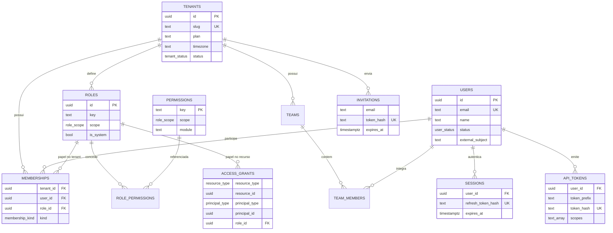
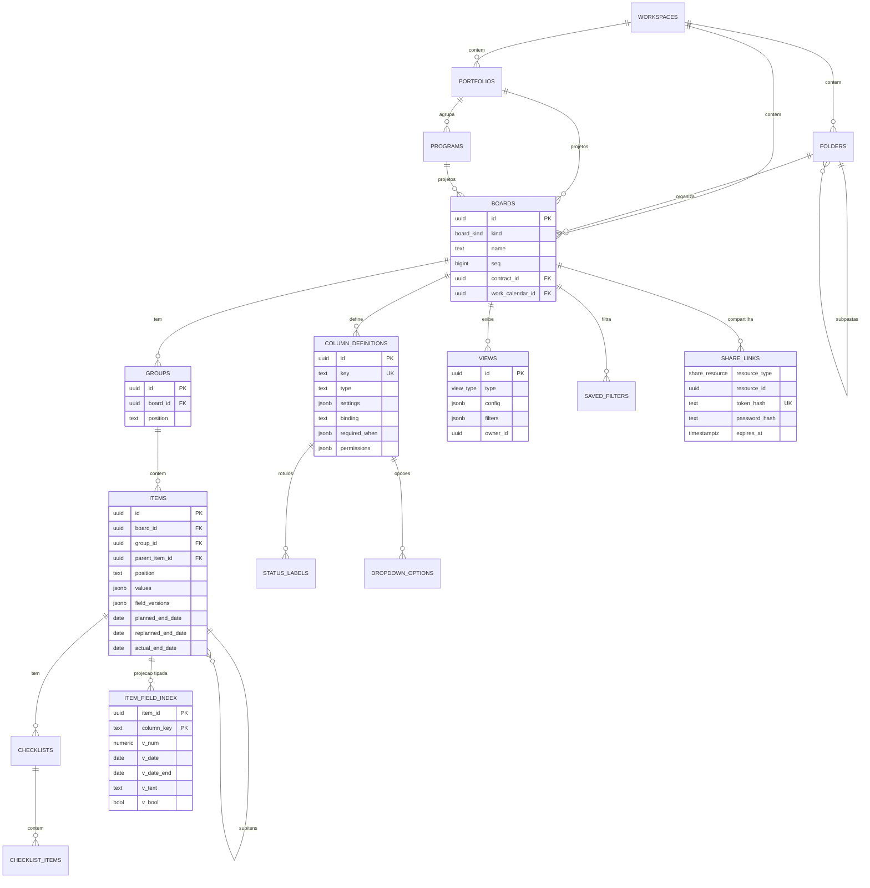
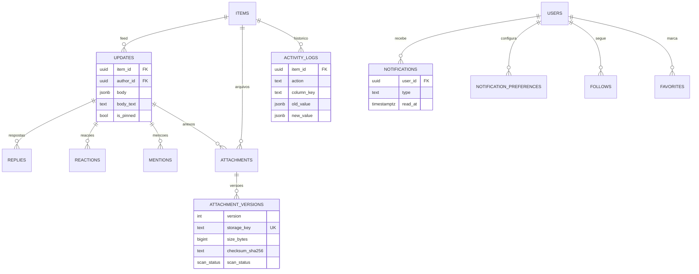
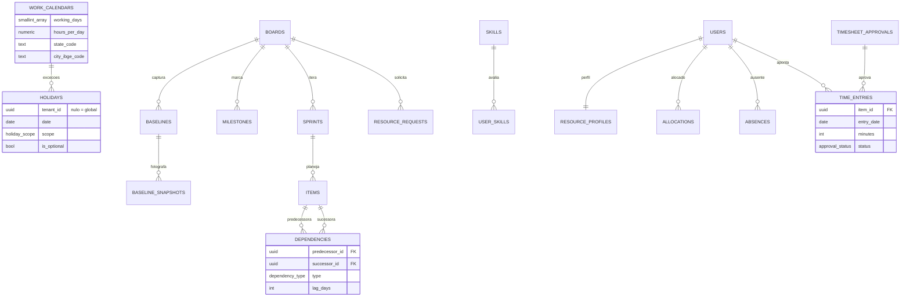
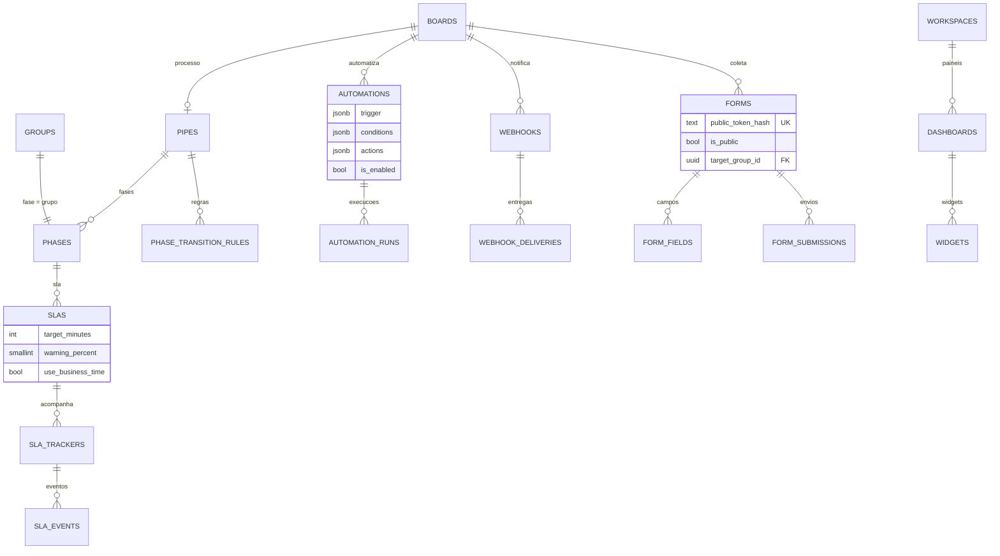
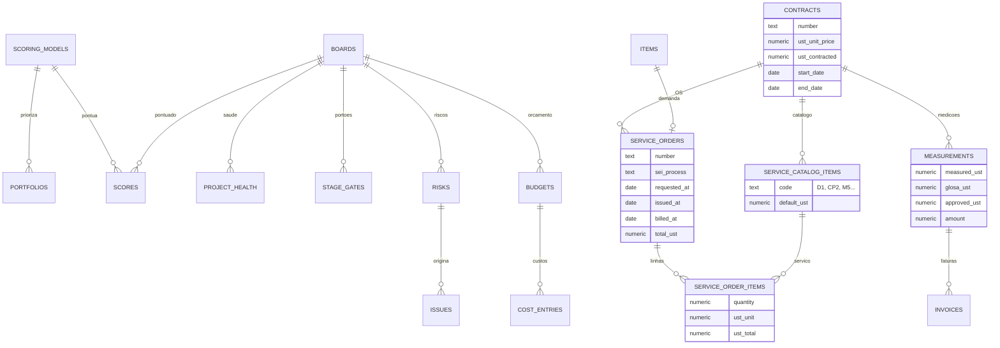
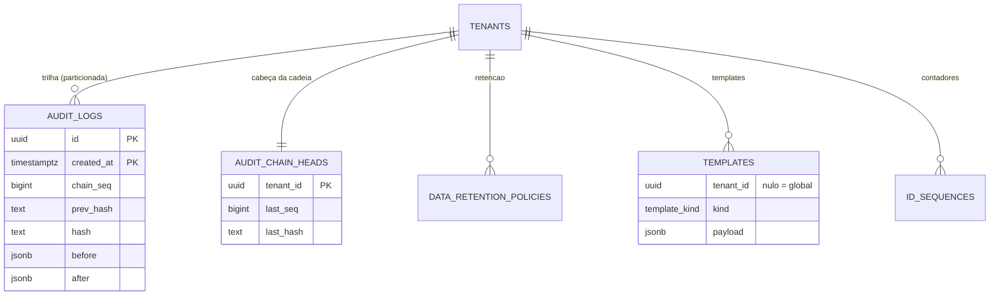

# CUBE TRACK — Modelo de dados

> Status: **Prompt 2** — implementado em `packages/db` (Drizzle + migrações SQL).
> Decisões: ADRs 0004, 0005, 0013, 0014, 0015, 0019 e 0020–0025.

Sumário

1. [Convenções](#1-convenções)
2. [Diagramas ER](#2-diagramas-er)
3. [Entidades](#3-entidades)
4. [Isolamento (RLS) e privilégios](#4-isolamento-rls-e-privilégios)
5. [Índices](#5-índices)
6. [Funções e triggers](#6-funções-e-triggers)
7. [Seed de demonstração](#7-seed-de-demonstração)
8. [Como rodar](#8-como-rodar)

---

## 1. Convenções

| Regra                      | Detalhe                                                                                                                                                                                                                                   |
| -------------------------- | ----------------------------------------------------------------------------------------------------------------------------------------------------------------------------------------------------------------------------------------- |
| Colunas padrão             | `id` (UUIDv7), `tenant_id`, `created_at`, `updated_at`, `created_by`; `deleted_at` (soft delete) onde aplicável                                                                                                                           |
| IDs                        | UUIDv7 gerado na aplicação (`newId()`), com _default_ `app.uuid_v7()` para inserts SQL                                                                                                                                                    |
| Isolamento                 | `UNIQUE (tenant_id, id)` em toda tabela de negócio; FKs compostas `(tenant_id, x_id) → alvo(tenant_id, id)` impedem referências entre tenants                                                                                             |
| `ON DELETE SET NULL`       | Em FKs compostas usa `SET NULL (coluna)` (PostgreSQL 15+) para não anular `tenant_id`                                                                                                                                                     |
| Posição manual             | `position text COLLATE "C"` com fractional indexing (ADR 0013)                                                                                                                                                                            |
| Dinheiro e UST             | `numeric(18,4)`; trafegam como string decimal                                                                                                                                                                                             |
| Datas de negócio           | `date` (sem fuso): prazos, términos, faturamento. Instantes: `timestamptz`                                                                                                                                                                |
| Enums                      | `pgEnum` para vocabulários estáveis; tipos de coluna e de widget são `text` validados pelo registro em `packages/shared`                                                                                                                  |
| `created_by`               | Sem FK (é metadado de auditoria; preserva o histórico mesmo após anonimização). Relações de negócio com usuários (`owner_id`, `author_id`…) têm FK                                                                                        |
| Exceções às colunas padrão | `item_field_index` (projeção derivada, PK `(item_id, column_key)`), `audit_logs` (PK `(id, created_at)` por particionamento), tabelas append-only sem `updated_at` (`activity_logs`, `sla_events`, `form_submissions`), catálogos globais |

---

## 2. Diagramas ER

Os diagramas mostram as colunas-chave; a lista completa está no schema (`packages/db/src/schema`).

### 2.1 Identidade e acesso



### 2.2 Estrutura, customização e views



### 2.3 Colaboração



### 2.4 Planejamento e recursos



### 2.5 Processos, automação, formulários e dashboards



### 2.6 Portfólio e contratos (módulo opcional)



### 2.7 Governança



---

## 3. Entidades

### Identidade e acesso

| Tabela                       | Descrição                                                                                                                    |
| ---------------------------- | ---------------------------------------------------------------------------------------------------------------------------- |
| `tenants`                    | Organização (raiz do isolamento): slug, plano, locale, fuso, moeda, região de dados                                          |
| `users`                      | Identidade **global** (um usuário em vários tenants). E-mail único (case-insensitive), vínculo com IdP (`external_subject`)  |
| `memberships`                | Usuário × tenant, com papel de tenant e `kind` (`member` / `guest` = convidado externo)                                      |
| `roles` / `role_permissions` | Papéis por tenant e escopo (tenant, workspace, board). 12 papéis de sistema criados no provisionamento + papéis customizados |
| `permissions`                | Catálogo **global** e somente leitura de permissões (`board.manage`, `contract.measure`…), carregado por migração            |
| `teams` / `team_members`     | Times, com líder                                                                                                             |
| `access_grants`              | Acesso de usuário/time a um recurso (workspace, pasta, portfólio, programa, board, dashboard) com um papel do escopo         |
| `invitations`                | Convites (token como hash, expiração, recurso opcional)                                                                      |
| `sessions`                   | Sessões com refresh token rotativo (hash), IP, user agent, revogação                                                         |
| `api_tokens`                 | Tokens de API (prefixo visível + hash), escopos, expiração e último uso                                                      |

### Estrutura

| Tabela                           | Descrição                                                                                                                                                                                                                               |
| -------------------------------- | --------------------------------------------------------------------------------------------------------------------------------------------------------------------------------------------------------------------------------------- |
| `workspaces`                     | Área de trabalho; `enabled_modules` ativa módulos opcionais (ADR 0017)                                                                                                                                                                  |
| `folders`                        | Pastas aninháveis; `kind = templates` para a pasta de templates                                                                                                                                                                         |
| `portfolios` / `programs`        | Hierarquia estratégica Portfólio → Programa → Projeto (board)                                                                                                                                                                           |
| `boards`                         | Contêiner universal de itens; `kind` = `board`, `project`, `process`, `backlog`. Liga-se a pasta, programa, portfólio, calendário e contrato. `seq` = sequência realtime                                                                |
| `groups`                         | Seções/raias do board (em processos, cada fase aponta para um grupo)                                                                                                                                                                    |
| `items`                          | Unidade de trabalho. `values` (JSONB) com colunas customizadas; datas nativas **planejado × replanejado × realizado** (início e término); progresso, estimativa, marco, sprint, fase. Subitem = `parent_item_id` (1 nível, mesmo board) |
| `item_field_index`               | Projeção tipada (`v_num`, `v_date`, `v_date_end`, `v_text`, `v_bool`) para filtros por faixa e ordenação — mantida por trigger (ADR 0020)                                                                                               |
| `checklists` / `checklist_items` | Checklists de itens/subitens, com responsável, prazo e conclusão                                                                                                                                                                        |
| `favorites`                      | Favoritos do usuário (workspace, pasta, board, dashboard, item, portfólio, programa)                                                                                                                                                    |
| `id_sequences`                   | Contadores dos IDs automáticos por coluna e período de reinício (ADR 0022)                                                                                                                                                              |

### Customização e views

| Tabela               | Descrição                                                                                                                                                                                                               |
| -------------------- | ----------------------------------------------------------------------------------------------------------------------------------------------------------------------------------------------------------------------- |
| `column_definitions` | Coluna do board: `key` estável, `type` (registro com ~32 tipos), `settings`, obrigatoriedade (`is_required` e `required_when` condicional), `permissions` (quem vê/edita), ordem, largura, `binding` (coluna vinculada) |
| `status_labels`      | Rótulos de colunas de status com cor e categoria (`not_started`, `in_progress`, `done`, `stuck`)                                                                                                                        |
| `dropdown_options`   | Opções de colunas dropdown                                                                                                                                                                                              |
| `views`              | Views salvas (tabela, kanban, calendário, timeline, gantt, formulário, mapa, gráfico, arquivos, carga, dashboard); pessoal (`owner_id`) ou compartilhada; padrão; ordem                                                 |
| `saved_filters`      | Filtros reutilizáveis (pessoais ou compartilhados)                                                                                                                                                                      |
| `share_links`        | Link público somente leitura: token como hash SHA-256, senha opcional, expiração, revogação, contagem de acessos                                                                                                        |

**Valores (`items.values`)**: mapa `{ columnKey: valor }` com formato por tipo definido em `packages/shared/src/columns/registry.ts` (ex.: número `{"n":"12.5"}`, data `{"d":"2026-11-30"}`, status `{"labelId":"…"}`, pessoas `{"personIds":[…],"teamIds":[…]}`, ID automático `{"text":"2026-0924","seq":924}`).

**Colunas vinculadas (`binding`)**: a fonte da verdade é um campo nativo (`item.planned_end_date`…) ou do módulo de contratos (`service_order.number`, `service_order.total_ust`…). Não são gravadas em `values`.

### Colaboração

| Tabela                                | Descrição                                                                                                 |
| ------------------------------------- | --------------------------------------------------------------------------------------------------------- |
| `updates` / `replies`                 | Atualizações (feed) e respostas; corpo em JSON do editor (Tiptap) + texto plano para busca; fixar; edição. `source` (`app`/`email`, ADR 0048) e `edit_history` (jsonb, histórico de versões anteriores, nunca apagado) |
| `reactions`                           | Reações com emoji em atualizações/respostas                                                               |
| `mentions`                            | @menções a usuário, time ou "todos" a partir de atualização, resposta ou descrição                        |
| `attachments` / `attachment_versions` | Arquivo lógico + versões imutáveis no object storage (chave por tenant, checksum, antivírus)              |
| `activity_logs`                       | Log de atividade visível ao usuário (append-only); distinto da auditoria                                  |
| `notifications`                       | Inbox in-app (lida/arquivada)                                                                             |
| `notification_preferences`            | Preferências por canal (in-app, e-mail, push), tipo de evento e frequência                                |
| `follows`                             | Inscrição em board, item ou dashboard                                                                     |
| `approval_requests` / `approval_approvers` | Pedido de aprovação de um item (ADR 0048): modo `all`/`any`, nota, status; um ou mais aprovadores com decisão (`approved`/`rejected`), comentário e data |

### Planejamento

| Tabela                             | Descrição                                                                                                                                             |
| ---------------------------------- | ----------------------------------------------------------------------------------------------------------------------------------------------------- |
| `dependencies`                     | Dependências FS/SS/FF/SF com lag em dias úteis (negativo = antecipação); sem auto-dependência                                                         |
| `baselines` / `baseline_snapshots` | Linhas de base do cronograma (uma primária por board) e a fotografia de cada item                                                                     |
| `milestones`                       | Marcos (opcionalmente ligados a um item)                                                                                                              |
| `sprints`                          | Sprints do módulo ágil (uma ativa por board)                                                                                                          |
| `work_calendars`                   | Dias úteis, jornada, fuso, UF e município (IBGE) para feriados                                                                                        |
| `holidays`                         | Feriados: **globais** (`tenant_id` nulo — nacionais, estaduais, municipais, carregados por migração para 2024–2035) ou do tenant (empresa/calendário) |

### Recursos

| Tabela                   | Descrição                                                                              |
| ------------------------ | -------------------------------------------------------------------------------------- |
| `resource_profiles`      | Perfil do usuário no tenant: cargo, gestor, capacidade semanal, custo/hora, calendário |
| `skills` / `user_skills` | Competências e nível (1–5)                                                             |
| `allocations`            | Alocação planejada por período (horas/dia) em board/item                               |
| `absences`               | Férias, licenças, treinamentos (com aprovação)                                         |
| `time_entries`           | Apontamentos de horas (manual/timer), faturável, status de aprovação                   |
| `timesheet_approvals`    | Aprovação de timesheet por usuário e período                                           |
| `resource_requests`      | Solicitações de recurso (perfil/competência, horas, período)                           |

### Processos e automação

| Tabela                   | Descrição                                                                                      |
| ------------------------ | ---------------------------------------------------------------------------------------------- |
| `pipes`                  | Configuração de processo (estilo Pipefy) de um board `process`                                 |
| `phases`                 | Fases (1:1 com grupos): tipo, campos obrigatórios, formulário da fase, limite WIP              |
| `phase_transition_rules` | Transições permitidas com condições, campos obrigatórios, papéis e aprovação                   |
| `slas`                   | SLA por fase/pipe, em minutos, com alerta (%), horário útil e condições de início/pausa/parada |
| `sla_trackers`           | Estado corrente do SLA por item (prazo, pausa, cumprido/violado)                               |
| `sla_events`             | Eventos de SLA (append-only)                                                                   |
| `automations`            | Regras "quando → se → então" (JSONB tipado), contadores de execução                            |
| `automation_runs`        | Execuções com profundidade (anti-loop), log e deduplicação por evento                          |
| `webhooks`               | Webhooks de saída (HTTPS obrigatório, segredo cifrado)                                         |
| `webhook_deliveries`     | Entregas com retentativa exponencial                                                           |

### Formulários e dashboards

| Tabela             | Descrição                                                                                   |
| ------------------ | ------------------------------------------------------------------------------------------- |
| `forms`            | Formulário que cria itens num grupo; público (token como hash) ou autenticado; encerramento |
| `form_fields`      | Campos mapeados para colunas, com condição de exibição                                      |
| `form_submissions` | Envios (append-only) e item gerado                                                          |
| `dashboards`       | Painéis com boards de origem, visibilidade, atualização automática                          |
| `widgets`          | Widgets (número, gráficos, bateria, carga…) com configuração e layout em grade              |

### Portfólio

| Tabela                      | Descrição                                                                          |
| --------------------------- | ---------------------------------------------------------------------------------- |
| `scoring_models` / `scores` | Modelos de priorização com critérios ponderados e pontuação por projeto            |
| `project_health`            | Série histórica de saúde (geral, prazo, custo, escopo, qualidade, risco, SPI, CPI) |
| `stage_gates`               | Portões de decisão do ciclo de vida                                                |
| `risks` / `issues`          | Riscos (probabilidade × impacto 1–5, estratégia, planos) e problemas               |
| `budgets` / `cost_entries`  | Orçamento (de um único dono: projeto, programa ou portfólio) e lançamentos         |

### Contratos (módulo opcional)

| Tabela                  | Descrição                                                                                                               |
| ----------------------- | ----------------------------------------------------------------------------------------------------------------------- |
| `contracts`             | Contrato com o órgão: número, processo SEI, vigência, valor da UST, UST contratadas, valor total                        |
| `service_catalog_items` | Catálogo do edital (Código Edital: D1, D3, CP2, M5…) com UST padrão                                                     |
| `service_orders`        | OS vinculada à demanda (item): número, processo SEI, datas (solicitada, emitida, entregue, aceita, faturada), UST total |
| `service_order_items`   | Linhas da OS: serviço × quantidade (check garante `ust_total = quantidade × ust_unit`)                                  |
| `measurements`          | Medições por período com UST medida, glosa e aprovada                                                                   |
| `invoices`              | Notas fiscais/faturas (chave NF-e de 44 dígitos)                                                                        |

### Governança

| Tabela                    | Descrição                                                                                                    |
| ------------------------- | ------------------------------------------------------------------------------------------------------------ |
| `audit_logs`              | Trilha de compliance **append-only**, **particionada por mês**, com **hash encadeado por tenant** (ADR 0021) |
| `audit_chain_heads`       | Último `chain_seq`/`hash` por tenant (mantido apenas pelo trigger)                                           |
| `data_retention_policies` | Retenção por tipo de entidade (dias, ação, base legal LGPD)                                                  |
| `templates`               | Templates de workspace/board/item/automação/dashboard/formulário; `tenant_id` nulo = template global         |

---

## 4. Isolamento (RLS) e privilégios

Contexto por transação: `select app.set_context(tenant_id, user_id)` (usa `set_config(..., true)`), encapsulado em `withTenant()` (`packages/db/src/client.ts`).

| Tabelas                                     | RLS                | Política                                                                                                                              |
| ------------------------------------------- | ------------------ | ------------------------------------------------------------------------------------------------------------------------------------- |
| Todas com `tenant_id NOT NULL` (83 tabelas) | `ENABLE` + `FORCE` | `tenant_isolation`: `USING (tenant_id = app.current_tenant_id()) WITH CHECK (mesma condição)`, aplicada por `app.enable_tenant_rls()` |
| `tenants`                                   | `ENABLE` + `FORCE` | `tenant_self`: apenas a linha do tenant corrente                                                                                      |
| `users` (global)                            | `ENABLE`           | `SELECT`: o próprio usuário ou quem tem membership no tenant corrente; `UPDATE`: apenas o próprio. `INSERT` só via `app.ensure_user`  |
| `holidays`, `templates` (tenant opcional)   | `ENABLE`           | Leitura de globais + do tenant; escrita apenas com `tenant_id` do tenant corrente                                                     |
| `audit_logs`                                | `ENABLE` + `FORCE` | `SELECT`/`INSERT` do tenant corrente; partições sem privilégios diretos e com RLS sem políticas                                       |
| `permissions` (catálogo global)             | —                  | Somente `SELECT` para os papéis da aplicação                                                                                          |

Sem contexto, `app.current_tenant_id()` é nulo e **nenhuma linha** é visível ou gravável (_fail closed_).

**Papéis de banco**

| Papel            | Uso                                                        | Privilégios                                                                                                                                  |
| ---------------- | ---------------------------------------------------------- | -------------------------------------------------------------------------------------------------------------------------------------------- |
| migrator (dono)  | Migrações e seed                                           | Dono das tabelas (sujeito a `FORCE RLS`), membro de `platform_admin`                                                                         |
| `app_rw`         | API, realtime, worker                                      | DML sujeito a RLS; sem `INSERT/DELETE` em `users`; só `INSERT/SELECT` em `audit_logs`; somente leitura em `permissions` e `item_field_index` |
| `app_ro`         | Réplicas, relatórios                                       | `SELECT` sujeito a RLS                                                                                                                       |
| `platform_admin` | Dono das funções `SECURITY DEFINER`; suporte de plataforma | `BYPASSRLS`; uso auditado                                                                                                                    |

---

## 5. Índices

| Índice                                      | Finalidade                                                                                                           |
| ------------------------------------------- | -------------------------------------------------------------------------------------------------------------------- |
| `items_board_group_position_idx`            | Listagem principal (Tabela/Kanban): `(board_id, group_id, position)` **parcial** para itens ativos de nível superior |
| `items_parent_position_idx`                 | Subitens ordenados (parcial)                                                                                         |
| `items_board_archived_idx`                  | Itens arquivados (parcial)                                                                                           |
| `items_values_gin_idx`                      | **GIN `jsonb_path_ops`** em `values` — filtros `@>` (status, pessoas, dropdown, tags)                                |
| `items_name_trgm_idx`                       | Busca textual no board (`pg_trgm`)                                                                                   |
| `items_board_updated_idx`                   | Sincronização incremental / reconexão                                                                                |
| `items_board_planned_end_idx`               | Calendário, prazos e alertas (parcial)                                                                               |
| `item_field_index_{num,date,text,bool}_idx` | Ordenação/faixa por coluna customizada: `(board_id, column_key, v_*, item_id)` — cursor estável                      |
| `*_position_idx`                            | Ordenação manual de grupos, colunas, views, pastas, checklists (parciais, sem excluídos)                             |
| `notifications_user_unread_idx`             | Inbox não lida (parcial)                                                                                             |
| `sla_trackers_due_idx`                      | SLAs em execução por vencimento (parcial)                                                                            |
| `audit_logs_tenant_entity_idx`              | Histórico de auditoria por entidade                                                                                  |
| Únicos parciais                             | View padrão por board, sprint ativa, baseline primária, calendário padrão, pipe por board, OS por item               |

---

## 6. Funções e triggers

| Objeto                                                                    | Descrição                                                                                                                |
| ------------------------------------------------------------------------- | ------------------------------------------------------------------------------------------------------------------------ |
| `app.uuid_v7()`                                                           | Gera UUIDv7 (default das PKs)                                                                                            |
| `app.current_tenant_id()` / `app.current_user_id()` / `app.set_context()` | Contexto da transação                                                                                                    |
| `app.enable_tenant_rls(regclass)`                                         | Aplica o padrão de RLS a uma tabela nova                                                                                 |
| `*_set_updated_at`                                                        | Trigger `BEFORE UPDATE` em todas as tabelas com `updated_at`                                                             |
| `items_assign_auto_ids`                                                   | Preenche colunas `auto_id` no insert (`app.next_sequence` + `app.format_display_id`)                                     |
| `items_validate_hierarchy`                                                | Subitens com no máximo 1 nível                                                                                           |
| `items_project_values_{insert,update}`                                    | Mantém `item_field_index` (`app.project_value` espelha o registro de tipos); `app.reproject_board()` reprocessa um board |
| `audit_logs_chain`                                                        | Calcula `chain_seq`, `prev_hash` e `hash` (SHA-256) por tenant                                                           |
| `audit_logs_append_only` / `_no_truncate`                                 | Bloqueiam UPDATE, DELETE e TRUNCATE, inclusive para o dono                                                               |
| `app.verify_audit_chain(tenant)`                                          | Lista registros adulterados (vazio = cadeia íntegra)                                                                     |
| `app.ensure_audit_partitions(from, months)`                               | Cria partições mensais (executado pelo worker; 25 meses criados na migração)                                             |
| `app.ensure_user(email, name)`                                            | Cria/retorna usuário global (SECURITY DEFINER)                                                                           |
| `app.resolve_share_link(hash)` / `app.resolve_public_form(hash)`          | Resolvem links públicos sem contexto de tenant (SECURITY DEFINER)                                                        |
| `app.user_tenants(user)`                                                  | Organizações de um usuário (seletor no login)                                                                            |
| `app.easter_sunday(year)` / `app.load_brazilian_holidays(from, to)`       | Feriados móveis e carga do catálogo                                                                                      |
| `app.business_days_between(calendar, from, to)`                           | Dias úteis considerando calendário, feriados nacionais, estaduais, municipais e do tenant                                |

---

## 7. Seed de demonstração

`pnpm db:seed` cria (de forma idempotente, sob RLS, numa transação):

- Tenant **Empresa Demo** (`empresa-demo`), 12 papéis de sistema, calendário São Paulo/SP, políticas de retenção.
- **8 usuários** (proprietária, admin/PMO, gerente de projetos, analista de processos, desenvolvedores, UX, financeiro leitor) e **1 convidado externo** (fiscal do contrato), times, preferências de notificação, convite pendente e token de API.
- Workspace **Área de trabalho principal** com as pastas Implantações Concluídas, Sustentação, Projetos Concluídos, Demandas internas e Templates; portfólio **Contratos Públicos** e programa **PMSP – Transformação Digital**.
- Contrato **012/2025** com o catálogo do edital (D1, D2, D3, D4, D6, D7, D9, CP1, CP2, CP5, M3, M5).
- Board **PMSP** (`kind = project`) com os grupos Demandas em Análise / em Andamento / Concluídas, as 18 colunas do caso de referência (ID automático `2026-0901…`), frentes, órgãos e **60 demandas** realistas com responsáveis, datas planejado/replanejado/realizado, OS, processos SEI, UST, atualizações com @menções, respostas, reações, anexos, subitens, checklists, dependências, baseline, marcos, medições e faturas.
- Views (Quadro principal, Kanban por Frente, Prazo de Entrega, Formulários, Mapeamento, Cronograma, Project Health, Atrasadas, A faturar), formulário público, link público somente leitura, dashboard Project Health, automações, webhook (desativado), saúde, riscos, problemas, orçamento.
- Recursos: perfis, competências, alocações, ausências, solicitação de recurso e timesheet de duas semanas com aprovação.
- Board ágil **Melhorias internas** (sprint ativa), board de processo **Triagem de solicitações** (pipe, fases, SLA com violação) e template **Contrato UST**.

Tokens públicos de demonstração: link `demo-pmsp-share-token`, formulário `demo-pmsp-form-token` (no banco só existem os hashes).

---

## 8. Como rodar

```bash
cp .env.example .env
pnpm install
pnpm infra:up          # PostgreSQL, Redis, MinIO, Meilisearch, Mailpit
pnpm db:migrate        # aplica migrações (papel dono)
pnpm db:seed           # popula a Empresa Demo
pnpm db:reset          # recria tudo (bloqueado em produção); --no-seed para só migrar
pnpm test              # unitários + integração (RLS, auditoria, triggers, seed)
```

Gerar migração após alterar o schema: `pnpm db:generate` (tabelas) ou `pnpm --filter @cube-track/db exec drizzle-kit generate --custom --name=<nome>` (SQL manual: RLS, funções, triggers). Toda tabela nova com `tenant_id` deve chamar `select app.enable_tenant_rls('public.<tabela>')` — o teste `rls.test.ts` falha se alguma ficar sem RLS.

---

## 9. Benchmark (50 mil itens)

`pnpm --filter @cube-track/db db:bench [quantidade]` cria um tenant descartável (rollback ao final) com um board de 50 mil itens e 5 colunas customizadas, e mede a mediana de 5 execuções (`EXPLAIN ANALYZE`, tempo no servidor). Resultado em PostgreSQL 16 local (container de desenvolvimento, sem tuning):

| Consulta                                                  | Mediana |
| --------------------------------------------------------- | ------- |
| Carga de 50 mil itens (com triggers de projeção)          | 9,7 s   |
| Página de 100 por grupo e posição                         | 0,06 ms |
| Filtro por status (GIN `@>`) + página de 100              | 23,7 ms |
| Filtro por pessoa (GIN `@>`) + ordenação por número + 100 | 42,2 ms |
| Ordenação por número (projeção) + cursor + 100            | 31,4 ms |
| Faixa de datas (projeção) + ordenação + 100               | 0,6 ms  |
| Agregação: soma de UST por status (board inteiro)         | 97,3 ms |
| Contagem por grupo (board inteiro)                        | 19,1 ms |

Conclusões: todas as consultas de página ficam abaixo da meta de 80 ms (ADR 0005). Agregações sobre o board inteiro ficam perto de 100 ms — por isso dashboards e rollups de portfólio usarão pré-agregação no worker (ADR 0005, item 6). O benchmark revelou um custo quadrático na carga em massa (411 s), corrigido evitando o `DELETE` da projeção em `INSERT`. Otimizações de ordenação com cursor (planos com _index-only scan_) ficam para o Prompt 16.
